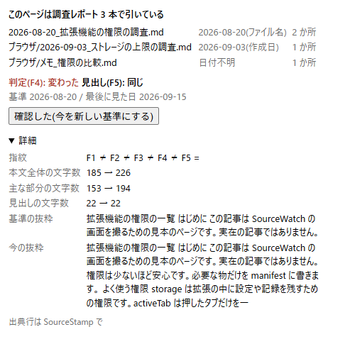
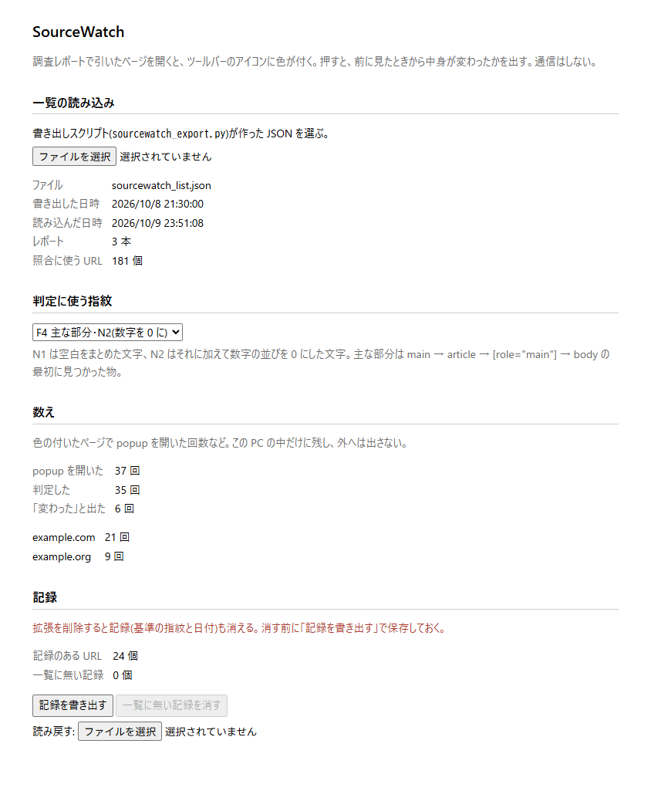

# SourceWatch

調査レポートで出典として引いたページを開いたとき、前に見たときから中身が変わったかを知らせる Chrome 拡張です。

- **書き出しスクリプト**(`export/`): Obsidian の vault の調査レポート(Markdown)から `[文字](https://…)` のリンクを抜き出し、一覧の JSON にします。vault は読むだけです。
- **拡張**(`extension/`): 一覧を読み込むと、一覧にあるページを開いたときだけツールバーのアイコンに色が付きます。押すと、そのページを引いているレポートと、前に見たときから変わったかを出します。

Obsidian の非公式のツールです。Obsidian の開発元とは関係ありません。

## 主な機能

- **一覧の読み込み**(オプションページ): 書き出しスクリプトが作った JSON を選ぶと、形を確かめてから保存します。形が違えば前の一覧を残します。
- **アイコンの色**: 一覧にあるページでだけアイコンが有効になります。照合はブラウザの `declarativeContent` が行い、拡張はページの URL も中身も受け取りません。
- **popup**: アイコンを押すと、そのページを引いているレポート(日付の古い順)と、判定を出します。
  - 初めて見たページは「今を基準にする」、2 回目からは「変わった / 変わっていない / 判定できない」
  - 基準は「確認した」を押したときだけ新しくします
  - 判定の後、アイコンにバッジ(`+` 初めて・`=` 変わっていない・`!` 変わった・`?` 判定できない)が付きます
- **指紋**: 本文全体・主な部分(`main` → `article` → `[role="main"]` → `body`)・見出しの文字から 5 種類(F1〜F5)の SHA-256 を作ります。数字の並びを 0 にした形(日付や閲覧数の揺れを消す)もあり、どれで判定するかをオプションページで選べます(既定は F4 = 主な部分・数字を 0 に)。入力欄・`contenteditable`・`script`・`style` などの中の文字は読みません。
- **記録の書き出しと読み戻し**: 基準の指紋と日付を JSON に書き出し、入れ直した後に読み戻せます。
- **数え**: popup を開いた回数・判定した回数・「変わった」と出た回数を、この PC の中だけに数えます。

## 画面

popup(一覧にあるページで、前に見たときから本文が変わっていたところ。画面用の見本のページです):



オプションページ(見本の一覧を読み込んだところ):



## 動作環境

- Chrome 153 以降(パソコン版)
- 書き出しスクリプトは Python 3.11 以降。標準ライブラリだけで動きます。
- 権限は次の 4 つだけです。`host_permissions` はありません。
  - `declarativeContent`: 一覧にあるページでだけアイコンを有効にするため(拡張は URL を受け取りません)
  - `activeTab`・`scripting`: アイコンを押したタブの本文の文字を、押したときに 1 回だけ読むため
  - `storage`: 一覧・記録(指紋・文字数・題 120 字まで・抜粋 160 字まで・日付)・設定・数えを残すため
- **通信はしません。** ページを取りに行くことも、外へ送ることもありません。判定は、自分でページを開いてアイコンを押したときだけです。

## 入れ方

1. このリポジトリをダウンロードして展開します。
2. `chrome://extensions` を開き、「デベロッパー モード」を ON にします。
3. 「パッケージ化されていない拡張機能を読み込む」で、展開したフォルダの中の **`extension` フォルダ** を選びます(リポジトリの根ではありません)。
4. 初めて入れたときはオプションページが開きます。次の「一覧を作る」で作った JSON を選びます。

ビルドはありません。ファイルをそのまま読み込みます。

### 一覧を作る

`export` フォルダで:

```
python sourcewatch_export.py --vault <vault のフォルダ> --out <vault の外の出力先>/sourcewatch_list.json
```

- 読むのは `--reports-dir`(既定 `レポート/調査レポート`、vault の根からの相対パス)の下の `.md` だけです。
- レポートの日付は、frontmatter の `--date-keys`(既定 `rf_surveyed_on,作成日`)、無ければファイル名の先頭の `YYYY-MM-DD` から取ります(`--no-filename-date` で使わない)。
- `--out` が vault の中を指していると、何も書かずに終了コード 1 で止まります。
- 標準出力に、リンク・URL・ホストの数、URL の多いホストの上位 10 件、日付をどこから取ったかの内訳が出ます。ほかのオプションは `--help` で見られます。

## テスト

書き出しスクリプト(Python 3.11 以降)。`export` フォルダで:

```
python -m pip install pytest
python -m pytest
```

拡張の純関数と本文の読み取りの試験は、ブラウザのページで回します。拡張を読み込んだあと、`chrome://extensions` で拡張の ID を見て、

```
chrome-extension://<拡張の ID>/tests/tests.html
```

を開きます。ページの上に `PASS n / FAIL 0` と出れば通っています。依存パッケージはありません。

`extension/tests/fixtures/` は手で確かめるための見本のページと一覧です。`list_test.json` には `http://localhost:8765/a.html` などが入っているので、`extension/tests/fixtures` で `python -m http.server 8765` を動かし、その一覧を読み込むと、見本のページで色付きのアイコンと判定を試せます。

## 同梱物

`extension/lib/format.js` は、同じ作者の Chrome 拡張 SourceStamp の `format.js` の写しです(MIT)。URL の照合で、`utm_*` を外す処理(`normalizeUrl`)だけを使っています。

## ライセンス

[MIT](LICENSE)

## 開発状況

v0.1.0 の段階です。窓なしの Chrome での読み込みとテストは通っていますが、普段の Chrome での手触り(アイコンの色の付き方など)はまだ確かめていません。
